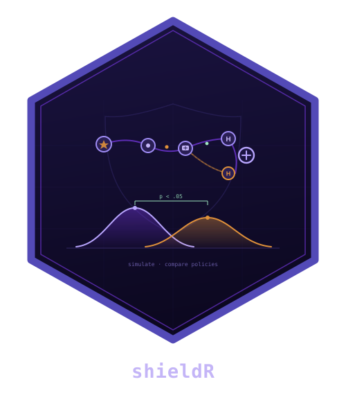

# shieldR 

[](https://lifecycle.r-lib.org/articles/stages.html#experimental)
[](LICENSE.md)

[](https://github.com/CTTIR/shieldR/actions/workflows/R-CMD-check.yaml)

**Simulate abstract logistics chains under dynamic challenges.**

`shieldR` models a fixed five-leg network in which logistics items compete for
finite transport and processing resources. Item specifications can change over
time, observations can be delayed or imperfect, and disruptions can alter route
risk and delivery outcomes. Compare allocation rules from R or explore synthetic
scenarios in the optional Shiny workbench.

An item represents an abstract unit of flow. Its class, condition index,
degradation flag and viability describe model states, not physical measurements
with universal units. Mapping these states to a particular logistics application
requires an explicit interpretation and validation. The supplied topology and
condition equations are fixed research assumptions, not a general network solver.

## Installation

Install the development version:

```r
install.packages("remotes") # once, if needed
remotes::install_github("CTTIR/shieldR", build_vignettes = TRUE)
```

R 4.1.0 or later is required. The simulation core uses R's bundled `parallel`,
`stats` and `utils` packages and contains no compiled code. 

For a local checkout, run `R CMD INSTALL .` from its directory. To include the
rendered tutorials, install `knitr` and `rmarkdown`, make Pandoc available, and
build the source archive first with `R CMD build .`; install that archive.
`build_vignettes = FALSE` skips the tutorial build when Pandoc is unavailable.
The vignette sources remain readable in [`vignettes/`](https://github.com/CTTIR/shieldR/tree/main/vignettes).

The optional workbench uses `shiny`, `bslib`, `DT` and `ggplot2`:

```r
install.packages(c("shiny", "bslib", "DT", "ggplot2"))
```

R itself and dependency installation requirements follow your operating system.
The package core does not require Rtools, Java, a database, or a network service.
PDF downloads use Cairo when its runtime is usable, with a portable vector PDF
fallback for systems such as macOS without XQuartz.

## Quick start

```r
library(shieldR)
set.seed(20260512)
scenario <- example_scenario(N = 6L)
master_seed <- 20260512L
fixed <- simulate_shield(scenario, policy = "P0", n_rep = 10L,
                         seed = master_seed)
coupled <- simulate_shield(scenario, policy = "P3", n_rep = 10L,
                           seed = master_seed + 1L)
summarize_shield(fixed)
compare_policies(coupled$viable_stage2, fixed$viable_stage2,
                 label_x = "P3", label_y = "P0", B = 10000L)
```

The neutral example deliberately disables hazards and uses equal routes.
It illustrates the interface, not a claim of policy superiority.
`example_scenario("constrained")` illustrates finite resources and censoring.
Use `shield_parameters()` to specify a study scenario; reconstruct it when
changing inputs rather than modifying derived list fields.

## Time-varying logistics-item specifications

An item has a true condition and an observed specification. These need not agree:
observations can be noisy, missing, delayed or retained from an earlier time.
The basic model updates item classes and viability each minute. The optional
`with_item_model()` extension adds a dimensionless condition index, a degradation
indicator and finite-capacity processing at Stage 2. Processing can stabilize an
item; residual degradation and other losses can continue afterwards.

| Specification | Interpretation |
|---|---|
| `fragility` | Positive class-specific weights controlling susceptibility to loss |
| `obs_condition_index` | Latest delivered, noisy condition measurement; higher is better in this synthetic model |
| `obs_degradation` | Latest observed degradation flag |
| `obs_time`, `obs_missing` | Measurement time and whether the latest observation was missing |
| `refresh`, `delivery` | Observation interval and delivery delay in minutes |
| `useful_updates` | Whether later observations are delivered; does not stop underlying condition changes |

The observed fields belong to the internal `item_specs` state table. They are
used by the decision rules; ordinary run rows contain batch-level outcomes.
The index equation and its thresholds are synthetic, dimensionless assumptions,
not a physical sensor calibration. `with_decision_controls(..., item =
"initial_observed")` freezes the information used for decisions while item
conditions continue to evolve. The default `item = "updated"` uses delivered
updates. This separates information freshness from the physical process.

## Interactive workbench

```r
library(shieldR)
shield_app()
```

Start with a neutral teaching scenario, inspect its configuration, choose a
simulation design, and run a small experiment. The workbench brings scenario
controls, result plots, batch tables, inference and reproducible exports into
one interface. It uses the same simulation and comparison functions as the R
workflow. Optional app dependencies are checked when the launcher is called.

See the [interactive exploration tutorial](https://github.com/CTTIR/shieldR/blob/main/vignettes/interactive-exploration.Rmd)
for the workflow, the role of each view, and how to reproduce an exported run.
Large study grids and publication analyses belong in versioned analysis scripts.

## Paired interventions

```r
with_disruptions <- simulate_shield(scenario, "P3", "adaptive", n_rep = 10L,
                                seed = 20260512L, disruptions_enabled = TRUE)
without_disruptions <- simulate_shield(scenario, "P3", "adaptive", n_rep = 10L,
                                   seed = 20260512L, disruptions_enabled = FALSE)
compare_intervention(with_disruptions, without_disruptions)
```

These teaching inputs have zero exposure, so toggling disruptions has no effect.
For a user-specified nonzero disruption risk scenario, the same API estimates the total
modelled intervention contrast. It checks matching settings and replication
identities. Independent policy arms instead require distinct seeds.

## What the result contains

`simulate_shield()` returns a `shield_run`, which is a data frame with one row
per independent batch replication. It preserves scenario parameters, package
version and RNG kind as attributes.

| Columns or attributes | Meaning |
|---|---|
| `policy`, `disruption_model`, `disruptions` | Decision rule, disruption-response family and disruption enablement |
| `rep`, `cell_seed`, `replicate_seed` | Replication identity and reproducible seed schedule |
| `viable_stage1`, `viable_stage2`, `viable_stage3` | Proportions of the original batch arriving viable at each stage |
| `n_stage1`, `n_stage2`, `n_stage3` | Corresponding arrival counts |
| `t_stage2_med`, `t_stage3_med` | Within-batch median arrival times among arrivals, in minutes; `NA` when none arrive |
| `util_L1` ... `util_L5` | Busy vehicle minutes divided by available vehicle minutes over the administrative horizon |
| `n_dispatch`, `n_disruption`, `n_disruption_loss` | Realised traversals, disruption events and loss-causing disruption events |
| `n_pending` | Items viable without a recorded Stage 3 arrival when the simulation ends |
| `routeL1A` ... `routeL5C`, `entropy_L1` ... `entropy_L5` | Realised route counts and normalised route-use entropy |
| `hold_mean`, `hold_rate` | Within-batch mean realised hold and proportion of realised holds that are positive |
| `parameters`, `shieldR_version`, `rng_kind` attributes | Configuration and software provenance; retained by RDS serialization |

`summarize_shield()` reports medians and quartiles across replications, with
separate valid and missing counts. Its summary of arrival-time medians is a
median of batch medians, rather than a pooled item estimate. `hold_mean` is
an engine diagnostic within a batch; descriptive reporting across replications
still uses median and IQR.

## Model and interpretation

- Fixed five-leg topology, three routes per leg and finite one-item vehicles.
- In the base model, item deterioration and noisy reassessment apply until
  Stage 2: item-condition hazard stops at physical arrival, before unloading. Stage 3 is the terminal node.
- P0 uses initial true priority and a fixed route; P1 uses noisy reassessment;
  P2 learns route risk; P3 couples item priority, route, destination and hold.
- Same-time departures share pre-batch history. Observed disruption outcomes update
  beliefs before later dispatch decisions in the same minute.
- P3 knows the specified disruption-response family and response parameters. Its
  forecast and softmax rule are heuristics. P1/P2 are not factorial ablations.
- One row is one batch replication. `viable_stage2` is the primary arrival-viable
  endpoint; viable nonarrivals at the administrative horizon count as failures.
  Arrival-time medians are conditional on arrival; undefined times remain NA.
- Mann-Whitney U for two independent arms, Kruskal-Wallis for multiple arms,
  Cliff's delta, percentile bootstrap intervals, and explicit log-scale BH FDR.
  Bootstrap intervals capture Monte Carlo sampling uncertainty conditional on
  the model, not parameter or structural uncertainty.

### Function guide

| Task | Functions |
|---|---|
| Construct and validate a scenario | `example_scenario()`, `shield_parameters()` |
| Run and summarize batches | `simulate_shield()`, `summarize_shield()` |
| Schedule or replay individual batches | `replication_seeds()`, `simulate_replication()` |
| Compare independent policy arms | `compare_policies()`, `compare_multiple()` |
| Estimate a paired intervention | `compare_intervention()` |
| Adjust one prespecified comparison family | `adjust_fdr()` |
| Build explicit analysis pipelines | `mann_whitney_u()`, `bootstrap_statistic()`, `effect_magnitude()` |
| Explore interactively | `shield_app()` |

### Tutorials

| Tutorial | What you will learn |
|---|---|
| [Getting started](https://github.com/CTTIR/shieldR/blob/main/vignettes/getting-started.Rmd) | Run a first experiment, understand endpoints, validate inputs and save results |
| [Study design and reproducibility](https://github.com/CTTIR/shieldR/blob/main/vignettes/study-design.Rmd) | Set independent and paired seeds, perform nonparametric comparisons, apply FDR and replay a result |
| [Interactive exploration](https://github.com/CTTIR/shieldR/blob/main/vignettes/interactive-exploration.Rmd) | Configure the workbench, interpret its views and export a reproducible experiment |

After an installation that includes vignettes:

```r
vignette("getting-started", package = "shieldR")
vignette("study-design", package = "shieldR")
vignette("interactive-exploration", package = "shieldR")
help(package = "shieldR")
```

No top-level package code sets the caller's RNG seed. Simulation and bootstrap
calls restore the caller's RNG kind and state, including on errors.

## Development and evidence

```sh
Rscript --vanilla -e 'devtools::test()'
R CMD build .
R CMD check --no-manual shieldR_0.6.0.tar.gz
```

Use the archive version produced by `R CMD build` if it differs.

## Scope and licence

This public edition uses synthetic teaching inputs and abstract network stages.
It is licensed under MIT. Version 0.6.0 uses item-specification terminology in the public interface,
including `with_item_model()`, `item_specs`, `obs_condition_index` and
`viable_stage2`. Serialized configurations and analysis scripts from earlier
versions require explicit migration; they are not interchangeable. Existing study installations and their
validated numerical records are separate from this public edition.

No application-specific validation, allocation-rule superiority, or scientific certification is claimed.

## Authors and citation

R. Heller. Use `citation("shieldR")` for installed-version metadata and record
the exact package revision, scenario definition and `sessionInfo()` with each
analysis. Report reproducible problems using synthetic inputs in
[GitHub issues](https://github.com/CTTIR/shieldR/issues).

## Use of LLM tools

Where applicable, LLM tools were used for narrowly defined, non-authorial tasks:
copyediting, prose refinement, Markdown/LaTeX formatting, boilerplate scaffolding
(such as CI configurations and build scripts), and code refactoring. Tools included
[Chat AI](https://kisski.gwdg.de/leistungen/2-02-llm-service/), the KISSKI
(GWDG) service, and self-hosted **Mistral Small (24B, Apache-2.0)** served through
a local **vLLM architecture** on an Ubuntu Linux workstation with Intel
processors and NVIDIA GPUs. The self-hosted model ran locally, with no data sent
to third parties.

All scientific claims, methodological choices, analyses, interpretations and
conclusions remain the authors' own. Where applicable, LLM-generated material
must be reviewed and revised before inclusion, and references must be verified
against their DOI, arXiv ID or ISBN.

Local software setup: vLLM with Python/PyTorch, plus R and RStudio.
